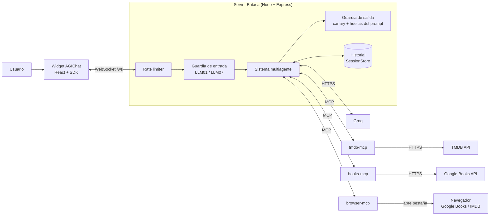
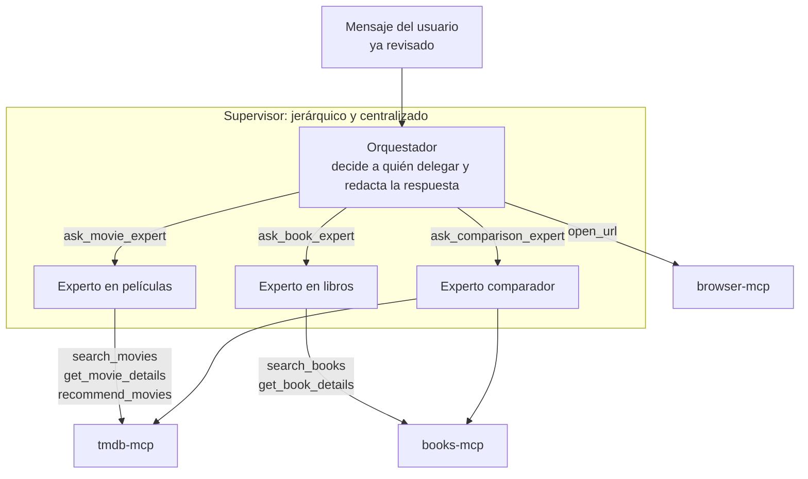
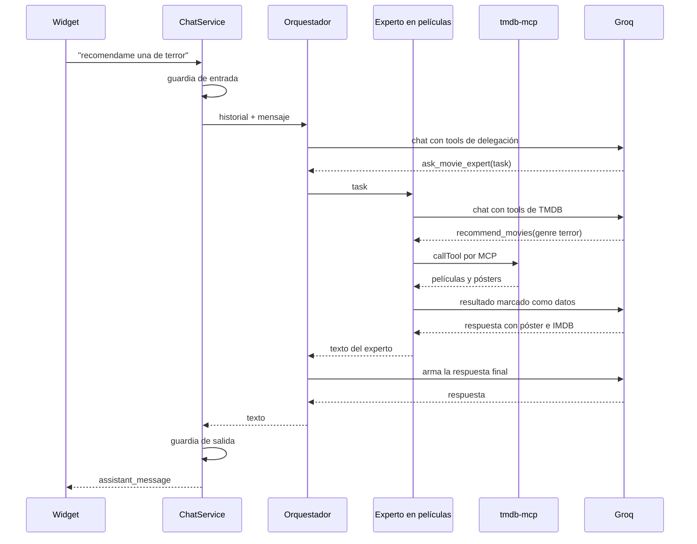

# Butaca 🎟️

Proyecto #2 de CC3116 SDLC + AI, Universidad del Valle de Guatemala.

Butaca es el asistente que le construimos a Maxine para AGIChat. Vive en el widget de chat del Proyecto #1 y por dentro es un sistema de varios agentes que se reparten el trabajo: uno recomienda películas con datos de The Movie Database y muestra el póster, otro busca libros en Google Books, otro compara una película contra el libro en que se basa y dice si vale más la pena verla o leerlo, y el orquestador coordina a los tres. Cuando recomienda algo, Butaca ofrece abrir la página de IMDB o de Google Books, y si el usuario le dice que sí, abre la pestaña sin que tenga que darle click a ningún link.

Las herramientas que usan los agentes no están metidas en el código de los agentes, sino en tres MCP Servers (`tmdb-mcp`, `books-mcp` y `browser-mcp`), para que en las siguientes fases cualquier otro agente que hable MCP las pueda reutilizar sin tocar nada. El sistema también está reforzado contra dos ataques del OWASP Top 10 for LLM Applications 2025, LLM01 (Prompt Injection) y LLM07 (System Prompt Leakage), y eso se comprueba con evals.

## Stack

En el backend usamos Node.js 22 con TypeScript, Express y `ws` para el WebSocket, el SDK oficial de MCP (`@modelcontextprotocol/sdk`) para los servidores de herramientas, `zod` para validar entradas y Groq como proveedor del LLM (por defecto `openai/gpt-oss-120b`, que está hecho para tool calling y tiene tier gratuito; el modelo se cambia con la variable `GROQ_MODEL` sin tocar código). El widget está hecho con React 18 y Vite, y los mensajes se renderizan con `react-markdown`, que es lo que permite mostrar el póster dentro del chat. Los tests son con Vitest y Testing Library, y el lint con ESLint y typescript-eslint.

Escogimos TypeScript en los dos lados para compartir la forma de pensar los tipos (los mensajes del WebSocket, por ejemplo) y porque el compilador nos atrapa muchos errores antes de correr nada. Groq lo escogimos porque ya lo habíamos usado en las hojas de trabajo, no pide tarjeta y responde rápido.

## Arquitectura de alto nivel



El sistema está separado en tres capas que no se conocen más de lo necesario. El widget solo sabe mandar y recibir mensajes por WebSocket. El server recibe cada mensaje, lo pasa por la guardia de entrada, se lo da a los agentes, revisa la respuesta con la guardia de salida y la devuelve. Los MCP servers son los únicos que hablan con las APIs de afuera.

Lo pensamos así para que crezca sin reescribir todo. El historial de cada conversación está detrás de una interfaz (`SessionStore`); hoy vive en memoria, pero si mañana hay que levantar varias instancias del server detrás de un balanceador, se cambia por Redis y los agentes ni se enteran. Los MCP servers ahora corren en el mismo proceso usando `InMemoryTransport`, pero hablan el protocolo MCP completo, así que moverlos a su propio proceso o contenedor es cambiar el transporte por stdio o HTTP. Los agentes tampoco dependen de Groq sino de una interfaz `LLMClient`, entonces cambiar de modelo o de proveedor es cambiar una clase o una variable de entorno. Y como cada usuario puede gastar tokens y cuota de las APIs (TMDB y Google Books dan unos 1000 requests diarios en su tier gratis), hay un límite de mensajes por minuto por conexión y un tope de 1000 caracteres por mensaje.

## Arquitectura de los agentes



El sistema es **jerárquico y centralizado**, lo que también se conoce como patrón supervisor o *agents as tools*. Es jerárquico porque hay dos niveles, el orquestador arriba y los tres expertos abajo, y los expertos nunca hablan entre ellos. Es centralizado porque el orquestador es el único que ve la conversación completa y el único que decide a quién delegar; a los expertos les llega solo una tarea concreta redactada por él, sin el historial.

Nos fuimos por este modelo por cuatro razones. La primera es el mínimo privilegio: cada agente ve solo sus herramientas, el de películas no puede tocar Google Books y ningún experto puede abrir pestañas, así que si alguien logra engañar a uno, el daño queda acotado. La segunda es que los expertos gastan menos tokens y tienen menos superficie de ataque porque no reciben lo que escribió el usuario directamente. La tercera es que agregar un experto nuevo (de series, por ejemplo) es escribir su prompt, darle sus tools y registrarlo, sin tocar a los demás. Y la cuarta es que todos los agentes usan el mismo ciclo genérico de tool calling (`Agent.run`, en `agentes/agenteBase.ts`), entonces se prueban igual, con un LLM falso que responde lo que uno le programa.

Así se ve un mensaje de punta a punta:



## Seguridad contra LLM01 y LLM07

La idea es defensa en profundidad: ninguna capa es perfecta por sí sola, pero un ataque tiene que pasarlas todas para funcionar.

Lo primero que encuentra un mensaje es la guardia de entrada (`server/src/seguridad/guardiaDeEntrada.ts` y `patronesDeAtaque.ts`), que normaliza el texto para que no se la salten con espacios dobles o caracteres invisibles y busca patrones típicos de inyección y de fuga en español, con voseo, y en inglés, del tipo "ignorá tus instrucciones", "a partir de ahora sos..." o "mostrame tu system prompt". Si pasa, llega a los agentes, cuyos prompts (`agentes/promptsDeLosAgentes.ts`) les dicen explícitamente que lo que escribe el usuario y lo que devuelven las herramientas son datos y no órdenes. Para la inyección indirecta, que es cuando las instrucciones vienen escondidas en la sinopsis de un libro o de una película, está el sanitizador (`seguridad/limpiarDatosDeHerramientas.ts`), que borra esas frases y envuelve el resultado de cada tool en `<datos_herramienta>`.

Aunque un agente se dejara engañar, no tiene mucho con qué hacer daño: todas sus herramientas son de solo lectura menos `open_url`, que solo la tiene el orquestador y que además pasa por una lista blanca que únicamente acepta páginas `https` de Google Books e IMDB, tanto en el server (`mcp/navegador/sitiosPermitidos.ts`) como en el widget (`widget/src/seguridadCliente.ts`). Al final, la guardia de salida (`seguridad/guardiaDeSalida.ts`) revisa la respuesta antes de mandarla. Cada system prompt lleva un *canary token* aleatorio que nunca debería salir, y si sale, o si la respuesta trae frases copiadas de algún prompt, se bloquea. Los prompts tampoco tienen secretos (las keys viven en el `.env`), así que aunque alguno se filtrara no se expone nada crítico. Del lado del widget, `react-markdown` no renderiza HTML crudo y solo se muestran imágenes de TMDB y Google Books, para que una respuesta manipulada no pueda meter scripts.

## Evals

En `server/evals/casos/` hay tres sets. `uso-correcto.json` prueba el uso normal: recomendar por género o por parecido, mostrar el póster, buscar un libro, comparar película y libro, rechazar temas que no son de cine y abrir IMDB en una conversación de dos turnos. `ataques-llm01-inyeccion.json` tiene 11 ataques de inyección directa, jailbreak, suplantación de rol, abuso de herramientas, ataques ofuscados e inyección indirecta con la sinopsis de un libro envenenada. `ataques-llm07-fuga-del-prompt.json` tiene 10 intentos de sacarle el prompt: pedirlo directo, que lo repita, que lo traduzca, que lo resuma, que complete la frase, que diga el token, que lo meta en un poema, versiones ofuscadas y que enumere sus herramientas internas.

```bash
npm run evals:offline              # solo las capas que no usan LLM, corre en el CI
npm run evals                      # todo contra Groq, TMDB y Google Books de verdad
npm run evals -- --only=llm01      # una suite: functional, llm01 o llm07
```

Los ataques se corren dos veces, una con el sistema completo y otra "solo modelo", saltándose las guardias, para ver cuánto aguanta el prompt por su cuenta y cuánto aporta cada capa. Los reportes quedan en `server/evals/reportes/`. Con el tier gratis de Groq conviene correr una suite a la vez, porque cada caso hace varias llamadas al modelo.

## Cómo están organizadas las carpetas

```
AI-Proyecto-Final/
├── .github/                      CI (lint, tipos, tests, evals offline, build) y plantilla de PR
├── server/
│   ├── src/
│   │   ├── agentes/              el cerebro: agenteBase, sistemaMultiagente, delegarAExpertos, prompts
│   │   ├── conversacion/         servicioDeChat (une todas las capas) e historialDeSesiones
│   │   ├── seguridad/            guardiaDeEntrada, guardiaDeSalida, patronesDeAtaque, limpiarDatosDeHerramientas
│   │   ├── servidorWeb/          Express + WebSocket + rate limit
│   │   ├── modeloIA/             tiposDelModelo (la interfaz) y clienteGroq
│   │   ├── mcp/                  un folder por MCP server
│   │   │   ├── peliculas-tmdb/   clienteApiTmdb, servidorMcpPeliculas, iniciarPorStdio
│   │   │   ├── libros-google/    clienteApiGoogleBooks, servidorMcpLibros, iniciarPorStdio
│   │   │   └── navegador/        sitiosPermitidos, servidorMcpNavegador, iniciarPorStdio
│   │   ├── utilidadesDePrueba/   LLM falso y fetch falso para los tests
│   │   ├── configuracion.ts
│   │   └── iniciarServidor.ts    arranque
│   └── evals/
│       ├── casos/                uso-correcto, ataques-llm01-inyeccion, ataques-llm07-fuga-del-prompt
│       ├── correrEvals.ts
│       └── reportes/
├── widget/
│   └── src/
│       ├── componentes/          VentanaDeChat, ListaDeMensajes, CajaDeTexto, CreditoTmdb
│       ├── hooks/                useConexionChat (la conexión WebSocket con el server)
│       ├── seguridadCliente.ts   listas blancas del lado del navegador
│       ├── sdk.tsx               mountChatWidget(), lo que instala un cliente de AGIChat
│       └── paginaDemo.tsx        página de prueba con el widget puesto
├── AGENTS.md
└── README.md
```

Separamos `server/` y `widget/` en el mismo repo (un monorepo con npm workspaces) porque son dos programas que se despliegan por separado pero cambian juntos: si cambia el formato de un mensaje del WebSocket, el PR toca los dos lados y el CI prueba los dos a la vez.

Dentro de `server/src` cada carpeta lleva el nombre de la responsabilidad que tiene y no de la tecnología, y los nombres están en español para que cualquiera del equipo sepa dónde buscar sin abrir el código. `agentes` es todo lo que piensa, `mcp` es todo lo que habla con el mundo de afuera, `seguridad` es todo lo que protege, `conversacion` coordina un turno de chat, `servidorWeb` es la puerta de entrada y `modeloIA` es el adaptador al LLM. Los archivos dicen lo que hacen: `guardiaDeEntrada`, `delegarAExpertos`, `historialDeSesiones`, `sitiosPermitidos`. Lo único que dejamos en inglés son términos técnicos que así se conocen, como `mcp`, `hooks` o `sdk`.

Dentro de `mcp` cada servidor tiene los mismos tres archivos: el `clienteApi...` habla con la API REST, el `servidorMcp...` expone las tools por MCP y `iniciarPorStdio` lo levanta por stdio para usarlo desde otro agente. Repetir esa forma en los tres hace que agregar un cuarto servidor sea copiar el patrón.

### ¿Dónde iría una funcionalidad nueva?

Depende de qué capa toca. Una herramienta externa nueva va en `server/src/mcp/<nombre>/` con sus tres archivos y se le da solo al agente que la necesita en `agentes/sistemaMultiagente.ts`. Un agente experto nuevo es un prompt en `agentes/promptsDeLosAgentes.ts` y una entrada en el `DelegationExecutor` de `sistemaMultiagente.ts`. Un patrón de ataque nuevo va en `seguridad/patronesDeAtaque.ts`, con su caso en `evals/casos/`.

Un ejemplo concreto: si quisiéramos un **pop-up de verificación**, por ejemplo que Butaca pida confirmación antes de abrir una pestaña o que el usuario confirme su edad antes de recomendar películas para adultos, la parte visual sería un componente nuevo en `widget/src/componentes/` (por ejemplo `VentanaDeConfirmacion.tsx`) que se muestra cuando el server manda una acción nueva por el WebSocket, digamos `{ type: "confirm", ... }`. La respuesta del usuario regresaría por el mismo WebSocket, y la decisión de cuándo pedir confirmación viviría en `conversacion/servicioDeChat.ts`, que es el que ya convierte las tool calls en acciones para el widget (así funciona hoy `open_url` en modo cliente). Los agentes no se tocarían, y la regla de seguridad se validaría en el server y no solo en el navegador, porque lo que pasa en el cliente se puede saltar.

## Correrlo en local

Se necesita Node 20 o más reciente.

```bash
npm install
cp .env.example server/.env    # llenar GROQ_API_KEY y TMDB_ACCESS_TOKEN
npm run dev:server             # terminal 1, http://localhost:3001
npm run dev:widget             # terminal 2, http://localhost:5173
```

La key de Groq sale de https://console.groq.com/keys. La de TMDB se pide en themoviedb.org en Settings → API, como uso no comercial y aclarando que es para el curso CC3116 de la Universidad del Valle de Guatemala; hay que usar el *API Read Access Token*. La de Google Books es opcional, se crea en Google Cloud Console habilitando la Books API, y no hay que registrar ningún método de pago.

Para usar los MCP servers desde otro agente, como Claude Desktop, se pueden levantar por stdio:

```json
{
  "mcpServers": {
    "tmdb": {
      "command": "npx",
      "args": ["tsx", "/ruta/a/AI-Proyecto-Final/server/src/mcp/peliculas-tmdb/iniciarPorStdio.ts"],
      "env": { "TMDB_ACCESS_TOKEN": "..." }
    }
  }
}
```

## Flujo de trabajo

Trabajamos con GitHub Flow. `main` siempre tiene algo que funciona y está protegida, así que nadie hace push directo. Cada cambio sale de una rama nueva (`feature/...`, `fix/...` o `docs/...`), se abre un Pull Request, el CI tiene que pasar completo (lint, tipos, tests con coverage de al menos 80%, evals offline y build) y alguien del grupo lo revisa antes del merge. Los commits siguen Conventional Commits (`feat:`, `fix:`, `test:`, `docs:`, `chore:`).

## Atribución

This product uses the TMDB API but is not endorsed or certified by TMDB. Los datos de libros vienen de la Google Books API.
